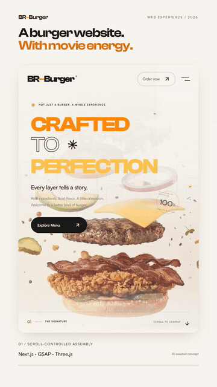
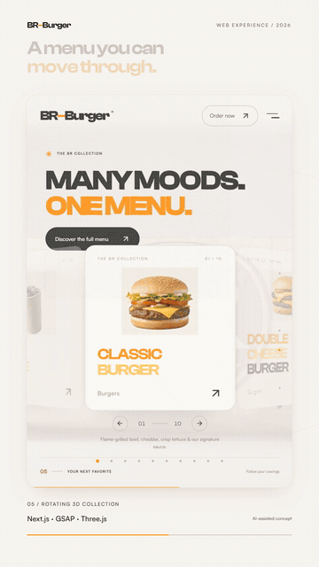
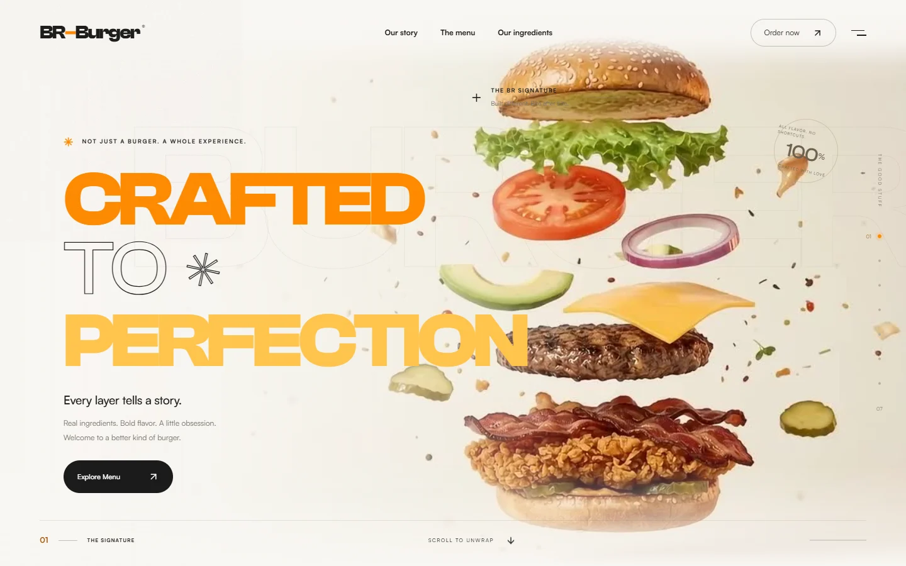
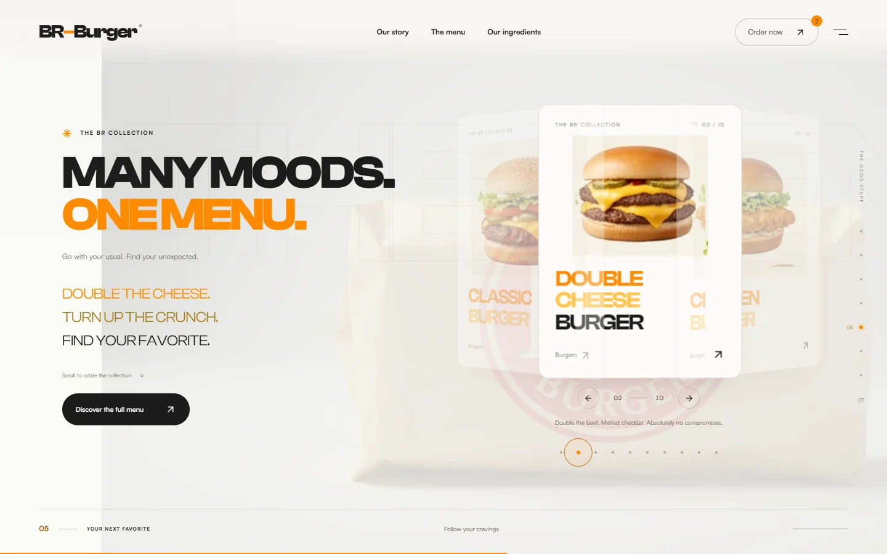

<div align="center">

# BR–Burger

### Your scroll is the play button.

A cinematic fast-food concept, brought to life through seven chapters of food, motion, and interactive design.


[Watch the 30-second showcase](deliverables/linkedin/BR-Burger-LinkedIn-30s.mp4) · [Run locally](#run-locally) · [Technical notes](docs/TECHNICAL.md)




*Actual website recordings from the portrait showcase.*

</div>

## A menu with movie energy

Scroll to assemble a signature burger, explore crispy sides and cold drinks, reveal the packaging, and move through a rotating collection of ten menu items. Scrolling backward rewinds the story.



| Chapter | Experience |
| --- | --- |
| 01 · Signature | Floating ingredients and burger assembly |
| 02 · Crunch | A cinematic taco reveal |
| 03 · Sides | Fries and an ice-cold drink |
| 04 · Wrapped | Packaging assembly |
| 05 · Collection | Ten items in a rotating 3D menu |
| 06 · Fresh | Ingredients in the spotlight |
| 07 · Finale | The complete BR-Burger lineup |

## Built for interaction

- **Scroll-controlled film:** reversible video seeking and chapter crossfades in a shared full-screen layer.
- **Interactive menu:** a CSS 3D carousel with swipe, pointer tilt, arrow keys, and direct item selection.
- **Living typography:** character reveals, motion paths, and scroll-responsive lettering.
- **Responsive delivery:** 1080p desktop footage, lighter 720p mobile copies, and nearby chapter preloading.
- **Motion preferences:** a reduced-motion photographic story with smooth scrolling, video loading, and particles disabled.
- **Demo ordering:** filtering, quantities, totals, review, and copying your selection.



This is a fictional brand and a portfolio concept. The order drawer is a demo; there is no payment processing or order backend. Food footage and the overall concept are AI-assisted.

## Run locally

Use Node.js 20.9 or newer and npm.

```bash
git clone https://github.com/AHMEDALIGHORI/BR-BURGER.git
cd BR-BURGER
npm ci
npm run dev
```

Open [localhost:3000](http://localhost:3000). The images, videos, and fonts needed to run the experience are included.

```bash
# Production
npm run build
npm start

# Validation
npm run typecheck
npm run test:e2e
```

Browser checks require a running server. Install the test browser with `npx playwright install chromium` if needed. Set `BASE_URL` to test a different local server.

## Under the hood

Next.js App Router · React · TypeScript · Tailwind CSS · GSAP / ScrollTrigger / MotionPathPlugin · Lenis · Framer Motion · React Three Fiber / Drei · SplitType.

The menu uses CSS perspective; React Three Fiber renders the optional WebGL crumb effects. Clash Display and Satoshi are hosted locally.

| Directory | Contents |
| --- | --- |
| `src/` | App, chapters, animation orchestration, and menu interactions |
| `public/assets/` | Optimized photographs, posters, and desktop/mobile videos |
| `Asssts/` | Supplied original media |
| `scripts/` | Asset preparation, browser checks, audits, and video creation |
| `docs/` | Animated README media and technical details |
| `deliverables/linkedin/` | Finished video, cover, caption, tags, and posting notes |

## Measured performance

Local production Lighthouse results are recorded in [the audit summary](docs/lighthouse-summary.json).

| Profile | Performance | Accessibility | Best practices | SEO |
| --- | ---: | ---: | ---: | ---: |
| Desktop | 99 | 96 | 100 | 100 |
| Mobile | 71 | 96 | 100 | 100 |

These are measurements from one local run, not guarantees for every device or host. Run `node scripts/audit-performance.mjs` against a production server to measure your environment.

## Share the project

- [30-second portrait video](deliverables/linkedin/BR-Burger-LinkedIn-30s.mp4) — 1080 × 1920, H.264 + AAC, 30 fps.
- [Video cover](deliverables/linkedin/BR-Burger-LinkedIn-cover.jpg).
- [LinkedIn caption and hashtags](deliverables/linkedin/LinkedIn-caption.txt).
- [Posting notes](deliverables/linkedin/Posting-notes.md).

To recreate the video, run `node scripts/make-linkedin-showcase.mjs` with the local website running. To recreate the README media, run the browser checks to generate screenshots, then `node scripts/make-readme-media.mjs`.

## Asset notes

Supplied clips are independent renders. The website connects them with reversible dissolves; source footage can retain embedded text or visual discontinuities. See [the implementation checklist](PROMPT-CHECKLIST.md) and [technical notes](docs/TECHNICAL.md) for details.

Clash Display and Satoshi are by Indian Type Foundry and subject to Fontshare's license terms. This repository does not grant a separate license to third-party fonts or supplied media.
